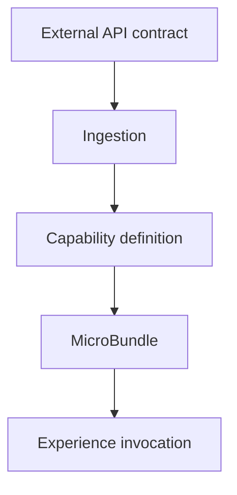

# TheSingularityWorkshop.MicroBundleIngestor

> **The ingestion boundary for turning external APIs into reusable capabilities.**

An API contract can be represented as a capability so an Experience can provide required data and invoke it without embedding a bespoke API client everywhere.

## 🟦 01 What

It converts an external contract into a reusable capability definition. Ingestion and binding are distinct from invoking the external service.

## 🟣 02 Why

External APIs are often trapped inside application-specific clients. Treating an API contract as a capability gives Experiences a reusable composition boundary while keeping ingestion, data binding, and actual invocation distinct.

## 🔺 03 How

Separate external-contract ingestion from capability definition and runtime invocation. Content-producing APIs may also yield durable artifacts, which should have their own identity and lifecycle.

## 🟢 04 See it in a minute

Start with the multiple API paths section below and use the documented tests to validate the current ingestion and capability contracts.

## 🟪 05 Documentation and theory

[Multiple API paths](#multiple-api-paths) · [Repository documentation](docs/)

---

## Detailed guide

The Forge needs a way to turn an external capability into something an Experience can understand.

This repository is the ingestion and capability-definition boundary.

## The central idea

An API is not necessarily just something the application calls.

It can itself become a reusable MicroBundle:

    API contract
        |
        v
    capability definition
        |
        v
    MicroBundle
        |
        +-- required data
        +-- connected ports
        +-- FSM behavior
        |
        v
    API call on behalf of the Experience

That means an Experience can install a capability, provide the required data, connect that data to ports, and invoke the operation without embedding a bespoke API client.

## Multiple API paths

There are at least three useful paths.

### Capability API

The API contract becomes a reusable capability MicroBundle.

### Content-producing API

An API can produce durable or expensive content such as terrain, meshes, places, or world data. The result can become a separate content MicroBundle.

### Repository capability

The MicroBundle Repository is the first proving case.

Its capability is intentionally simple:

    Get(bundleId, version, contentHash)
    Put(artifact)

Forge is allowed to use Put. Other Experiences must not inherit Forge's publication authority.

The Ingestor therefore models the repository as a capability with an explicit Forge-only publication policy. The policy is descriptive; the repository host must enforce it.

## OpenAPI is an adapter, not the domain

The current URL adapter accepts OpenAPI/Swagger JSON and reduces it to a canonical API definition.

    URL
      |
      v
    OpenApiUrlIngestor
      |
      v
    ApiExperienceDefinition
      |
      v
    CapabilityCompiler
      |
      v
    CapabilityDefinition
      |
      v
    Forge

The capability model is transport-neutral. OpenAPI is only one way to discover a capability.

Future adapters can ingest other sources without changing the capability domain.

## Ports

Each capability operation exposes input and output ports.

The Ingestor supplies facts and semantic hints. Forge decides how those ports should be presented and wired.

For example:

- latitude and longitude can become one location control;
- an enum can become a selection control;
- a numeric constraint can become a slider;
- credentials can become a credential binding.

The Ingestor does not become a GUI framework.

## Visual Studio

The repository includes the traditional solution used by Visual Studio, containing:

- TheSingularityWorkshop.MicroBundleIngestor — executable/tooling project.
- TheSingularityWorkshop.MicroBundleIngestor.Tests — xUnit test project.

The solution is named TheSingularityWorkshop.MicroBundleIngestor.sln. The newer .slnx representation is retained as well.

## Current implementation

The current development line includes:

- OpenAPI/Swagger JSON ingestion;
- canonical API definitions;
- capability compilation;
- semantic port hints;
- the MicroBundle Repository capability definition;
- Forge-only repository Put policy metadata;
- unit tests for API ingestion and capability composition;
- deterministic, transport-neutral domain types;
- build validation through GitHub Actions.

The Repository capability can be printed with:

    MicroBundleIngestor --repository

An OpenAPI capability can be generated with:

    MicroBundleIngestor <openapi-or-swagger-json-url>

## REST integration

The REST NuGet package is intentionally isolated behind an explicit project property:

    UseMicroBundleRepositoryRest=true

The package is not a core dependency of the ingestion domain.

This is deliberate. The package currently has a publication/feed dependency, and this repository must remain buildable without silently substituting a project reference or coupling the capability model to HTTP transport.

Once the REST package is available from an approved feed, the integration path is:

    Forge / Ingestor
        |
        v
    capability definition
        |
        v
    MicroBundleRepository.Rest
        |
        v
    IMicroBundleRepository
        |
        v
    Repository host

No NuGet publication is performed by this repository.

## Documentation

- docs/DOMAIN.md — domain model, capability paths, ports, authorization boundary.
- docs/THEORY.md — address-space efficiency, sparse representation, and capability-space theory.

## Architecture boundary

This repository is not:

- Forge;
- a GUI framework;
- a general REST client;
- a storage provider;
- an Experience runtime;
- or a replacement for FSM_COS.

Its responsibility is to turn discovered capabilities into precise, reusable definitions that Forge can compose into Experiences.

The eventual path is:

    external capability
        |
        v
    ingestion
        |
        v
    capability definition
        |
        v
    deterministic MicroBundle
        |
        v
    Forge
        |
        v
    Experience
        |
        v
    FSM execution
